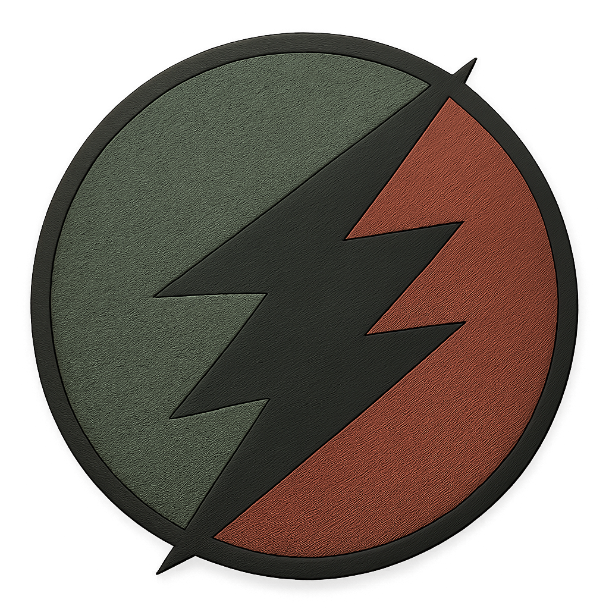
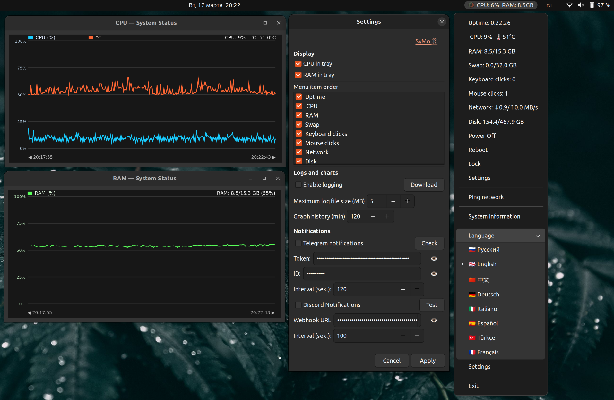

# SyMo ([RU](README_RU.md))



SyMo is a lightweight Linux tray system monitor (GTK): it shows system load,
controls power actions and sends notifications to Telegram and Discord.



## Features

- **Tray metrics:** CPU and temperature, RAM, swap, disk, network, uptime, key presses and mouse clicks.
- **Graphs** for every metric: mouse wheel zooms, drag pans, hover shows the point's values.
- **Power:** shutdown, reboot, lock, delayed actions with a timer.
- **Notifications:** Telegram bot (`/status`, `/screenshot` commands) and Discord webhook.
- **Settings:** menu item visibility and order, start on login, graph colors, logging.
- **8 languages:** Russian, English, Chinese, German, Italian, Spanish, Turkish, French.

## Requirements

Ubuntu 22.04 or newer (GNOME 42–50), x86_64.
The tray icon needs AppIndicator: Ubuntu ships it by default; on vanilla GNOME
install `gnome-shell-extension-appindicator`.

## Install

### Option 1. Ready-made package (recommended)

1. Download `symo_<version>_amd64.deb` from [Releases](https://github.com/OlegEgoism/SyMo/releases).
2. Install it:

   ```bash
   sudo apt install ./symo_*_amd64.deb
   ```

3. Start SyMo from the application menu. From then on it starts by itself when you log in.

### Option 2. Build from source

Run the commands in this order.

**1. Get the project**

```bash
git clone https://github.com/OlegEgoism/SyMo.git
cd SyMo
```

**2. Install system packages**

```bash
sudo apt install git python3-venv python3-gi python3-gi-cairo gir1.2-gtk-3.0 \
  gir1.2-ayatanaappindicator3-0.1 build-essential patchelf
```

**3. Set up the Python environment**

```bash
python3 -m venv --system-site-packages .venv
.venv/bin/pip install -r requirements-build.txt
```

> `--system-site-packages` is required. Without it pip fails with
> `Dependency "cairo" not found`. If `.venv` already exists without the flag
> (for example, created by PyCharm), delete it (`rm -rf .venv`) and repeat this step.

**4. Build the package** (a few minutes)

```bash
./build.sh
```

**5. Install**

```bash
sudo apt install ./dist/symo_*_amd64.deb
```

**6. Start** SyMo from the application menu or with the `symo` command.

To update, run `git pull` in the project folder, then steps 4 and 5.

> The package runs on the Ubuntu version it was built on and newer ones.

### Development mode (run `app.py`)

The app runs straight from source, no build needed. Code changes take effect
on the next restart.

**1. Get the project** — as in step 1 above.

**2. Install system packages** (no compiler or `patchelf` needed for this):

```bash
sudo apt install python3-venv python3-gi python3-gi-cairo gir1.2-gtk-3.0 \
  gir1.2-ayatanaappindicator3-0.1
```

**3. Create the environment and install the app's dependencies:**

```bash
python3 -m venv --system-site-packages .venv
.venv/bin/pip install -r requirements.txt
```

**4. Quit the installed SyMo** if it is running (*Exit* in the tray menu).
Only one instance runs at a time; otherwise `app.py` exits quietly and prints
`SyMo уже запущен` ("SyMo is already running") in the terminal.

**5. Start it:**

```bash
.venv/bin/python app.py
```

The icon appears in the tray and the log goes to the terminal. Stop it with `Ctrl+C` or *Exit* in the menu.

> **PyCharm:** *Settings* → *Python Interpreter* → *Add Interpreter* → *Existing* →
> `.venv/bin/python`, then run `app.py` (right-click → *Run 'app'*).
> If PyCharm creates `.venv` itself, tick *Inherit global site-packages*.

> The source version uses the same settings files (`~/.symo_*.json`) as the
> installed package.

## Configuration

- **Start on login:** *Settings* → *Display* → *Start SyMo when you log in*.
- **Telegram / Discord:** *Settings* → *Notifications*: bot token and chat ID, or webhook URL.
- The `/screenshot` command needs these tools:

  ```bash
  sudo apt install gnome-screenshot scrot grim imagemagick
  ```

## Uninstall

```bash
sudo apt remove symo
```

Settings and tokens stay in your home folder: `~/.symo_settings.json`,
`~/.symo_telegram.json`, `~/.symo_discord.json`. Delete them by hand if you don't need them.

## GNOME Shell extension

[](https://extensions.gnome.org/extension/9526/symo-launcher/)

[SyMo Launcher](https://extensions.gnome.org/extension/9526/symo-launcher/) adds an
**Open SyMo** button to the panel. The button hides while SyMo's own tray icon is shown.
Install the app itself separately (see above).

To install: `sudo apt install gnome-shell-extension-manager` → open
*Extension Manager* → *Browse* → **SyMo Launcher** → *Install*.

## For developers

| Path | Contents |
|---|---|
| `app.py`, `app_core/` | the app: tray, menu, metrics, graphs, settings |
| `notifications/` | Telegram and Discord |
| `gnome_extension/` | SyMo Launcher extension (GNOME 42–44 and 45+) |
| `build.sh` | build: `.deb`, archive and extension into `dist/` |
| `build-deb.sh`, `install.sh`, `uninstall-symo.sh` | packaging and per-user install (called by the build) |

The app version is `APP_VERSION` in `app_core/constants.py`; the extension version
is `version-name` in `gnome_extension/*/metadata.json`.

## License

Copyright © 2025–2026 OlegEgoism. SyMo and SyMo Launcher are licensed under the
GNU GPL version 2.0 or later (GPL-2.0-or-later). See [LICENSE](LICENSE).

## Contact

- Author: [OlegEgoism](https://github.com/OlegEgoism)
- Telegram: [@OlegEgoism](https://t.me/OlegEgoism)
- Email: olegpustovalov220@gmail.com
- Videos: [short](https://youtube.com/shorts/X1tlQ4XuLSM?feature=share), [overview](https://youtu.be/zvdoo9JA88k)
