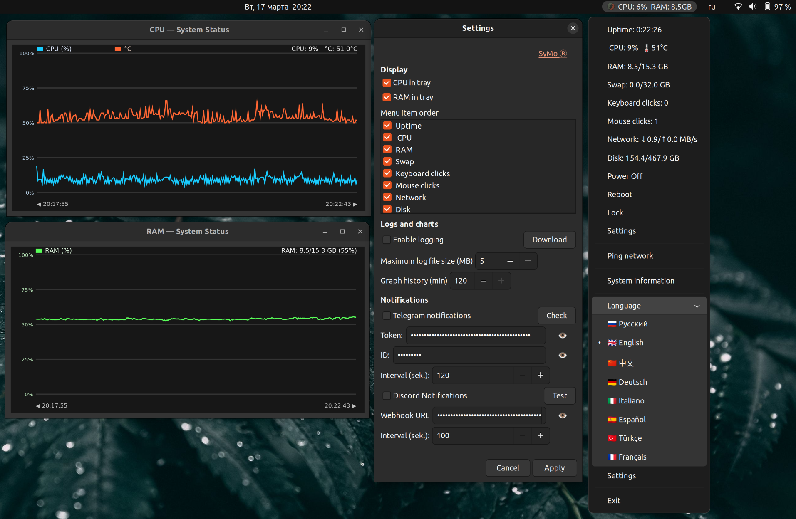

# SyMo ([EN](README.md))


SyMo — лёгкий системный монитор для трея Linux (GTK): показывает загрузку
системы, управляет питанием и шлёт уведомления в Telegram и Discord.



## Возможности

- **Метрики в трее:** CPU и температура, RAM, swap, диск, сеть, аптайм, нажатия клавиш и клики мыши.
- **Графики** по каждой метрике: колесо мыши — масштаб, перетаскивание — сдвиг, наведение — значения точки.
- **Питание:** выключение, перезагрузка, блокировка, отложенный запуск по таймеру.
- **Уведомления:** Telegram-бот (команды `/status`, `/screenshot`) и Discord webhook.
- **Настройки:** видимость и порядок пунктов меню, автозапуск при входе, цвета графиков, логирование.
- **8 языков:** русский, английский, китайский, немецкий, итальянский, испанский, турецкий, французский.

## Требования

Ubuntu 22.04 или новее (GNOME 42–50), архитектура x86_64.
Для значка в трее нужен AppIndicator: в Ubuntu он есть по умолчанию, в «чистом»
GNOME установите `gnome-shell-extension-appindicator`.

## Установка

### Способ 1. Готовый пакет (рекомендуется)

1. Скачайте `symo_<версия>_amd64.deb` со страницы [Releases](https://github.com/OlegEgoism/SyMo/releases).
2. Установите:

   ```bash
   sudo apt install ./symo_*_amd64.deb
   ```

3. Запустите SyMo из меню приложений. Дальше он будет запускаться сам при входе в систему.

### Способ 2. Собрать из исходников

Выполняйте команды по порядку.

**1. Скачайте проект**

```bash
git clone https://github.com/OlegEgoism/SyMo.git
cd SyMo
```

**2. Установите системные пакеты**

```bash
sudo apt install git python3-venv python3-gi python3-gi-cairo gir1.2-gtk-3.0 \
  gir1.2-ayatanaappindicator3-0.1 build-essential patchelf
```

**3. Подготовьте окружение Python**

```bash
python3 -m venv --system-site-packages .venv
.venv/bin/pip install -r requirements-build.txt
```

> Флаг `--system-site-packages` обязателен. Без него pip падает с ошибкой
> `Dependency "cairo" not found`. Если `.venv` уже создан без флага (например,
> PyCharm), удалите его (`rm -rf .venv`) и повторите шаг.

**4. Соберите пакет** (несколько минут)

```bash
./build.sh
```

**5. Установите**

```bash
sudo apt install ./dist/symo_*_amd64.deb
```

**6. Запустите** SyMo из меню приложений или командой `symo`.

Чтобы обновиться, выполните в папке проекта `git pull`, затем шаги 4 и 5.

> Пакет работает на той версии Ubuntu, где собран, и на более новых.

### Запуск в режиме разработки (через `app.py`)

Приложение запускается прямо из исходников, без сборки. Изменения в коде видны
сразу после перезапуска.

**1. Скачайте проект** — как в шаге 1 выше.

**2. Установите системные пакеты** (компилятор и `patchelf` для этого не нужны):

```bash
sudo apt install python3-venv python3-gi python3-gi-cairo gir1.2-gtk-3.0 \
  gir1.2-ayatanaappindicator3-0.1
```

**3. Создайте окружение и поставьте зависимости приложения:**

```bash
python3 -m venv --system-site-packages .venv
.venv/bin/pip install -r requirements.txt
```

**4. Закройте установленный SyMo**, если он запущен («Выход» в меню трея).
Одновременно работает только один экземпляр: иначе `app.py` молча завершится
с сообщением `SyMo уже запущен` в терминале.

**5. Запустите:**

```bash
.venv/bin/python app.py
```

Значок появится в трее, а лог пойдёт в терминал. Остановить — `Ctrl+C` или «Выход» в меню.

> **PyCharm:** *Settings* → *Python Interpreter* → *Add Interpreter* → *Existing* →
> `.venv/bin/python`, затем запускайте `app.py` (правый клик → *Run 'app'*).
> Если PyCharm сам создаёт `.venv`, включите в нём *Inherit global site-packages*.

> Версия из исходников использует те же файлы настроек (`~/.symo_*.json`), что и
> установленный пакет.

## Настройка

- **Автозапуск:** «Настройки» → «Отображение» → «Запускать SyMo при входе в систему».
- **Telegram / Discord:** «Настройки» → «Уведомления»: токен бота и ID чата или webhook.
- Для команды `/screenshot` нужны утилиты:

  ```bash
  sudo apt install gnome-screenshot scrot grim imagemagick
  ```

## Удаление

```bash
sudo apt remove symo
```

Настройки и токены лежат в домашней папке: `~/.symo_settings.json`,
`~/.symo_telegram.json`, `~/.symo_discord.json`. Удалите их вручную, если они не нужны.

## Расширение GNOME Shell

[](https://extensions.gnome.org/extension/9526/symo-launcher/)

[SyMo Launcher](https://extensions.gnome.org/extension/9526/symo-launcher/) добавляет
на панель кнопку **Open SyMo**. Кнопка скрывается, пока виден значок самого SyMo.
Само приложение нужно установить отдельно (см. выше).

Установка: `sudo apt install gnome-shell-extension-manager` → откройте
«Менеджер расширений» → «Просмотр» → **SyMo Launcher** → «Установить».

## Для разработчиков

| Путь | Что внутри |
|---|---|
| `app.py`, `app_core/` | приложение: трей, меню, метрики, графики, настройки |
| `notifications/` | Telegram и Discord |
| `gnome_extension/` | расширение SyMo Launcher (GNOME 42–44 и 45+) |
| `build.sh` | сборка: `.deb`, архив и расширение в `dist/` |
| `build-deb.sh`, `install.sh`, `uninstall-symo.sh` | упаковка и установка без root (вызываются из сборки) |

Версия приложения — `APP_VERSION` в `app_core/constants.py`, версия расширения —
`version-name` в `gnome_extension/*/metadata.json`.

Чтобы выпустить релиз, запушьте тег, совпадающий с `APP_VERSION`: `git tag v<версия> && git push origin v<версия>` — CI соберёт его на Ubuntu 22.04 и прикрепит все файлы из `dist/` к релизу на GitHub.

Чтобы выпустить релиз, запушьте тег, совпадающий с `APP_VERSION`: `git tag v<версия> && git push origin v<версия>` — CI соберёт его на Ubuntu 22.04 и прикрепит все файлы из `dist/` к релизу на GitHub.

## Лицензия

Copyright © 2025–2026 OlegEgoism. SyMo и SyMo Launcher распространяются по лицензии
GNU GPL версии 2.0 или более поздней (GPL-2.0-or-later). См. [LICENSE](LICENSE).

## Контакты

- Автор: [OlegEgoism](https://github.com/OlegEgoism)
- Telegram: [@OlegEgoism](https://t.me/OlegEgoism)
- Email: olegpustovalov220@gmail.com
- Видео: [короткое](https://youtube.com/shorts/X1tlQ4XuLSM?feature=share), [обзор](https://youtu.be/zvdoo9JA88k)

[README.md](README.md)
[README_RU.md](README_RU.md)
